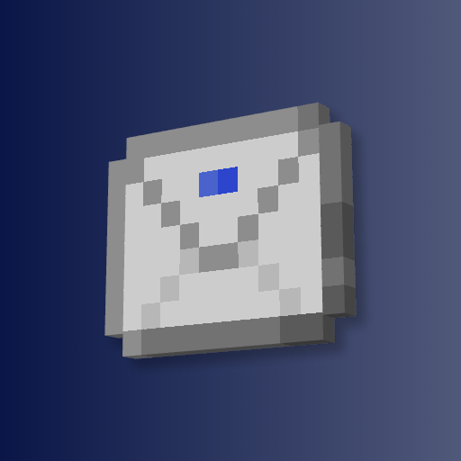

# BlockBird

Make Minecraft your email client! Receive emails directly during gameplay.

## Links and Socials - TODO UPDATE LINKS

  

## Project Info

### Description

**BlockBird** is a client-side mod that renders your Minecraft instance your email client!

This does not replace your actual email client but enables notifications to be received in-game.

Upon loading the game, you'll be able to configure BlockBird locally to use your email client of choice (Gmail, Outlook, Yahoo), specifying 
email and password for it to be accessed.
Upon joining a world, you'll receive a BlockBird toast notification informing you if the mod is either enabled
(everything has been correctly set up) or disabled (configuration is missing, or other issues occurred). 
If you receive a positive response, you'll receive all the new emails in the configured timespan 
as toast notifications!

*Note: the mod is still in BETA, so there might be bugs and issues related to it.*